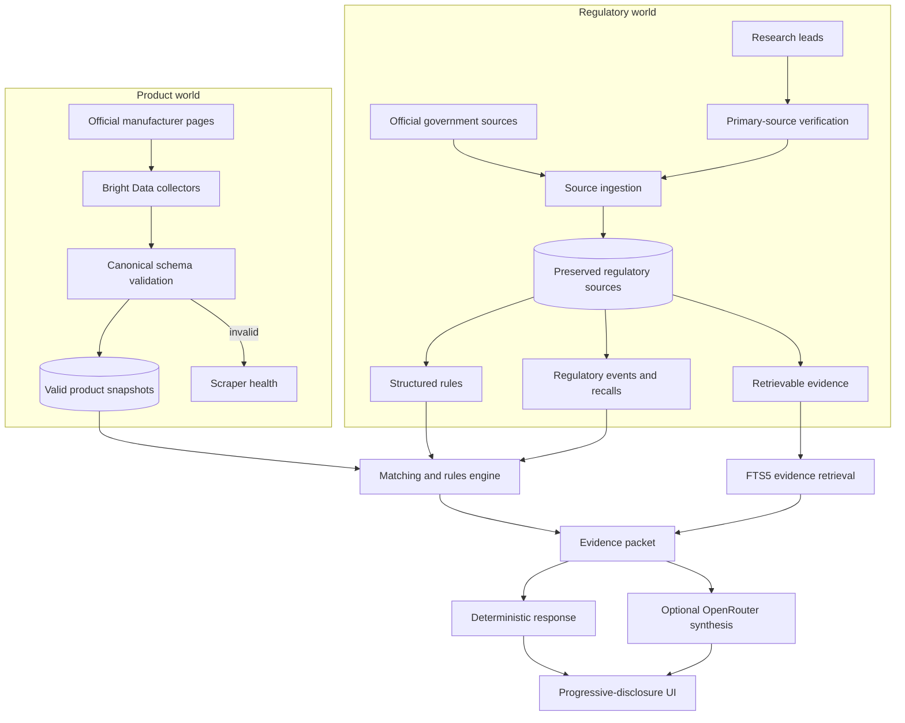

# RegLens data and intelligence architecture

RegLens joins two independently sourced worlds: current manufacturer product
facts and authoritative regulatory evidence. Neither is allowed to silently
overwrite or reinterpret the other.

## Processing model

### 1. Preserve raw evidence and provenance

Every accepted product snapshot retains its exact manufacturer URL, market,
and scrape time. Every regulatory source retains authority, jurisdiction,
canonical URL, retrieval time, source type, preserved content, and refresh
health. A failed refresh never replaces the last known good record.

### 2. Normalize without erasing the source

Product pages become the canonical Product Passport contract. Regulatory
documents become `RegulatorySource` records. Only unambiguous, applicable
statements become `RegulatoryRule` records. Regulatory changes and recalls
remain dated events rather than timeless product properties.

Catalog identity is separate from scraper output: a canonical family can have
multiple market variants, and each variant owns independent snapshots. For
example, `fanta-orange-ca` and `fanta-orange-sa` share `fanta-orange` as a
family while preserving separate source URLs, markets, ingredients, and label
bases.

### 3. Gate claims by evidence status

- `VERIFIED`: exact primary evidence and applicability are sufficient for a
  deterministic rule.
- `SUPPORTED`: authoritative contextual evidence may be displayed but does not
  automatically create a threshold conclusion.
- `NEEDS_REVIEW`: a research lead, ambiguous mapping, stale source, or secondary
  claim; never used for an automatic finding.

Teammate research enters as `NEEDS_REVIEW`. It is a discovery map, not a
production database. Promotion requires locating the primary regulator page,
preserving it, checking jurisdiction/category/effective dates, and recording an
evidence excerpt.

### 4. Resolve entities and applicability

Current matching is deliberately narrow: exact catalog identity, verified
caffeine rules, and conservative exact/product-family/brand recall matching.
Ingredient indexing retains every manufacturer label string and attaches a
canonical entity only through an exact preferred-name match or a separately
`VERIFIED` alias. Names such as `Red 40`, `FD&C Red No. 40`, `Allura Red AC`,
and `E129` are not assumed equivalent merely because they are plausible leads;
alias relationships require authoritative verification.

### 5. Compute before asking an LLM

Numeric comparisons are deterministic. The rules engine combines a stored
product value with a `VERIFIED` rule and emits a structured finding. The LLM is
given product facts, findings, relevant passages, recalls, and provenance; it
may explain them but cannot create or override a rule.

### 6. Serve cached intelligence

The normal UI reads SQLite rather than waiting on Bright Data or regulators.
Refresh operations validate new data first. Invalid product output degrades
scraper health while keeping the previous valid snapshot available.

## How users consume the data

RegLens uses three levels of disclosure:

1. **What should I know?** Homepage discoveries and short Product Passport
   findings show a small number of notable, source-backed facts.
2. **Why does RegLens say this?** Separate manufacturer, computed, regulatory,
   and recall cards expose the evidence lane behind each statement.
3. **Show the source.** Authority, jurisdiction, status, retrieval date, exact
   evidence, and official URL remain available for inspection.

The homepage `GET /api/discoveries` feed is generated from current stored
sources, rules, findings, and recalls. The frontend does not hardcode its
regulatory claims. Discovery cards may link to an investigation and the
official evidence, but never imply that RegLens has checked every country or
every regulatory database.

## Research-lead intake

When the teammate research artifact is supplied, each lead should include:

- proposed subject or ingredient;
- claimed jurisdiction and authority;
- source URL, if known;
- claimed rule/event and effective date;
- product/category applicability;
- research notes;
- status, initially `NEEDS_REVIEW`.

Review should prioritize leads that have an accessible primary government
source, a current first-party product match, and a materially different story.
Only after verification should a lead become preserved evidence, a structured
rule, or a homepage discovery.
