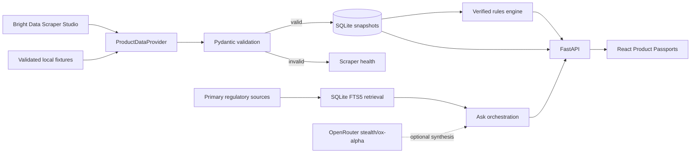

# RegLens

> **From product label to regulatory evidence.**

RegLens is a public, fixture-first prototype. It is designed to make the
boundary between manufacturer facts, regulatory evidence, deterministic
findings, and optional AI explanation easy to inspect.

RegLens is an evidence-centric product intelligence application for food and
beverages. It keeps manufacturer facts, authoritative regulatory evidence,
deterministic comparisons, and LLM interpretation visibly separate. It is not
a medical diagnosis tool and does not label a product simply safe or unsafe.

The fixture-first catalog covers fourteen manufacturer products across energy
drinks, soft drinks, candy, snacks, and instant noodles. Fanta Orange is kept as
separate Canadian and Saudi Arabian market formulations; product-family
identity never merges their snapshots or ingredient statements.

## What it does

- Builds Product Passports from one stable scraper contract.
- Serves validated cached snapshots when external services are unavailable.
- Compares nutrition and caffeine values without frontend hardcoding.
- Applies only `VERIFIED` regulatory rules to deterministic findings.
- Retains regulator authority, jurisdiction, excerpt, URL, and retrieval date.
- Matches official recall records conservatively as exact-product,
  product-family, or brand-level context.
- Answers questions with relevant product facts, findings, and cited evidence.
- Supports session-only multi-turn follow-ups and labels OpenRouter synthesis
  separately from deterministic fallback answers.
- Detects invalid collector output while preserving the last valid snapshot.
- Generates source-backed homepage discoveries from stored rules, evidence,
  findings, and recalls rather than hardcoding regulatory marketing claims.

## Architecture

See [ARCHITECTURE.md](ARCHITECTURE.md) for the complete data lifecycle,
research-lead verification flow, entity-normalization roadmap, and
progressive-disclosure UX model.



The default `fixture` mode makes no Bright Data or OpenRouter request. Live
adapters are enabled only through environment configuration.

### Runtime boundary

The tracked [`scrapers/`](scrapers/) directory contains reviewed Bright Data
Scraper Studio reference code and local parser regression material. Those
JavaScript files are not imported or executed by the FastAPI or React runtime.
For a live collector, a maintainer manually copies the reference
`interaction.js` and `parser.js` into a Bright Data Scraper Studio collector,
publishes the reviewed collector, and configures its Collector ID in `.env`.
The application consumes the collector's API output after canonical Pydantic
validation; it never evaluates repository scraper code.

## Evidence model

Regulatory evidence has one of three states:

- `VERIFIED`: primary authoritative evidence with sufficiently clear
  applicability for deterministic evaluation.
- `SUPPORTED`: authoritative contextual guidance that may be displayed but not
  converted into threshold logic.
- `NEEDS_REVIEW`: ambiguous, secondary, stale, or unresolved evidence. It does
  not generate findings.

The MVP's deterministic example uses Health Canada's statement that Canadian
caffeinated energy drinks can contain a maximum of 180 mg caffeine per serving.
RegLens compares current U.S. snapshots with that rule as regulatory context;
it does not conclude that the U.S. formulation is sold illegally in Canada.
Market-specific formulations may differ.

### Authoritative source corpus

RegLens preserves a small primary-source corpus before deriving rules:

- Health Canada caffeinated energy drink guidance
- Health Canada's List of Permitted Supplemental Ingredients
- FDA color-additive regulatory information
- FDA's dedicated FD&C Red No. 3 regulatory-action page
- Government of Canada Recalls and Safety Alerts open-data metadata

Each record retains authority, jurisdiction, canonical URL, source type,
retrieval time, cleaned source text, refresh status, and the last retrieval
error. `POST /api/sources/refresh` refreshes the known URLs independently. A
failed retrieval marks only that source degraded and preserves its last-known-
good text. Application startup remains offline-safe and never refreshes these
websites automatically.

Recall context comes from official data such as openFDA. Matching is cautious:
a brand or product-family record is never silently attributed to the current
SKU.

## Product Passport scraper contract

Every collector returns the same shape:

```json
{
  "brand": "string | null",
  "product_name": "string | null",
  "product_line": "string | null",
  "flavor": "string | null",
  "serving_size": {"value": "number | null", "unit": "string | null", "ml": "number | null"},
  "caffeine_mg": "number | null",
  "calories": "number | null",
  "sugar_g": "number | null",
  "nutrition_facts": [{"name": "string", "value": "number | null", "unit": "string | null", "daily_value_percent": "number | null"}],
  "ingredients": ["string"],
  "warnings": ["string"],
  "claims": ["string"],
  "source": {"url": "string", "market": "string", "scraped_at": "ISO-8601 timestamp"}
}
```

Unavailable scalar values use `null`; unavailable lists use `[]`. Category and
other RegLens metadata remain in the backend domain model so the collector
contract stays stable.

Collector transport metadata is deliberately separate. A collected result may
include `scraper_assets.nutrition_label_images`, whose entries must be
`{url, content_type: "image", purpose: "nutrition_label"}`. RegLens requires
these URLs to be HTTPS and first-party to the snapshot source domain. Invalid
asset metadata rejects the entire collected result: neither the current
snapshot nor previously accepted assets are replaced.

## Local setup

Requirements: Python 3.11+, `uv`, and Node.js 20+.

```bash
cp .env.example .env
uv sync
uv run uvicorn app.main:app --app-dir backend --reload
```

In a second terminal:

```bash
cd frontend
npm install
npm run dev
```

Open `http://localhost:5173`. Vite proxies `/api` and `/health` to FastAPI at
`http://localhost:8000`.

## Configuration

`.env` is ignored. Never commit API tokens.

```dotenv
REGLENS_DATA_PROVIDER=fixture
REGLENS_DATABASE_PATH=backend/data/reglens.db

OPENROUTER_API_KEY=
OPENROUTER_MODEL=stealth/ox-alpha

REGLENS_RATE_LIMIT_ENABLED=true
REGLENS_RATE_LIMIT_WINDOW_SECONDS=60
REGLENS_ASK_RATE_LIMIT=20
REGLENS_PRODUCT_REFRESH_RATE_LIMIT=6
REGLENS_SOURCE_REFRESH_RATE_LIMIT=2

BRIGHTDATA_API_TOKEN=
BRIGHTDATA_API_BASE_URL=https://api.brightdata.com
BRIGHTDATA_COLLECTOR_ALANI=
BRIGHTDATA_COLLECTOR_CELSIUS=
BRIGHTDATA_COLLECTOR_C4=
BRIGHTDATA_COLLECTOR_BLOOM=
BRIGHTDATA_COLLECTOR_RED_BULL=
BRIGHTDATA_COLLECTOR_BRACHS=
BRIGHTDATA_COLLECTOR_FANTA_SA=
BRIGHTDATA_COLLECTOR_FANTA_CA=
BRIGHTDATA_COLLECTOR_REIGN=
BRIGHTDATA_COLLECTOR_MOUNTAIN_DEW_CODE_RED=
BRIGHTDATA_COLLECTOR_DORITOS_NACHO_CHEESE=
BRIGHTDATA_COLLECTOR_CHEETOS_CRUNCHY=
BRIGHTDATA_COLLECTOR_MAGGI_MASALA=
BRIGHTDATA_COLLECTOR_NONGSHIM_SHIN_BIG_BOWL=
```

With no OpenRouter key, Ask RegLens returns a deterministic, source-grounded
local response. With a key, it uses OpenRouter Chat Completions at
`https://openrouter.ai/api/v1/chat/completions` with `stealth/ox-alpha` by
default. Product facts and rule results are assembled before synthesis; the LLM
does not create regulatory rules.

Ask, product-refresh, and regulatory-source-refresh endpoints use configurable
per-client, process-local rate limits to bound accidental provider spend. A
multi-worker public deployment should also enforce shared limits at its hosting
edge.

## Bright Data setup

Reviewed Studio reference files live under
`scrapers/products/<product-id>/`. They are maintained as source and are
intended to be copied manually into Studio; they are not an application plugin
or a runtime dependency. For each product:

1. Create a custom collector in Bright Data Scraper Studio.
2. Copy `interaction.js` into Interaction Code.
3. Copy `parser.js` into Parser Code.
4. Use the exact target URL documented in that scraper's README.
5. Run it in Studio and validate the JSON against the canonical contract.
6. Publish the working version and add its collector ID to `.env`.
7. Set `REGLENS_DATA_PROVIDER=brightdata` only after all desired collectors are
   configured.

The Bright Data CLI may be used without a global install:

```bash
npm_config_registry=https://registry.npmjs.org npx -p @brightdata/cli bdata scraper create <url> '<description>'
npm_config_registry=https://registry.npmjs.org npx -p @brightdata/cli bdata scraper run <collector-id> <url> --sync
```

The current CLI `scraper create` command generates a scraper from natural
language. It does not provide a supported command for uploading this
repository's reviewed `interaction.js` and `parser.js` verbatim. A CLI-created
collector is therefore not evidence that the checked-in parser was executed.
When the generated schema differs from the canonical contract, copy the local
files into Scraper Studio, preview, and publish there. Collector validation
status and manual steps are tracked in
[scrapers/COLLECTORS.md](scrapers/COLLECTORS.md).

The application does not call an undocumented self-healing API. A live refresh
triggers the configured collector, polls for output, validates it, and persists
only a valid snapshot. Failed or malformed output marks the source degraded and
leaves the last known good snapshot active.

### Manual self-healing demo

1. Show a healthy cached Product Passport.
2. Intentionally break a collector selector in Scraper Studio and run refresh.
3. Show `Invalid output` in Data Health while the prior snapshot remains live.
4. Repair the collector through Studio's natural-language development flow.
5. Publish/re-run the same collector and refresh RegLens.
6. Show the new valid snapshot and restored `Healthy` status.

## API

- `GET /api/products`
- `GET /api/products/{id}`
- `GET /api/products/{id}/assets`
- `POST /api/products/{id}/refresh`
- `GET /api/products/compare?ids=id1,id2`
- `GET /api/sources`
- `POST /api/sources/refresh`
- `GET /api/rules`
- `GET /api/discoveries`
- `GET /api/findings?product_id=...`
- `GET /api/recalls?product_id=...`
- `GET /api/scrapers/health`
- `POST /api/ask`

Interactive API docs are available at `http://localhost:8000/docs`.

## Quality gates

```bash
uv run ruff format .
uv run ruff check .
uv run pytest

cd frontend
npm run lint
npm run build
```

## Demo flow

See [DEMO_SCRIPT.md](DEMO_SCRIPT.md) for a concise live/video walkthrough.
Suggested screenshots for a submission: Catalog hero, Alani Product Passport,
three-product Compare, evidence-grounded Ask result, and degraded Data Health
with the cached snapshot preserved.

## Known limitations

- CELSIUS, Bloom, and C4 expose important nutrition content through imagery.
  RegLens retains first-party label URLs separately from canonical facts and
  never treats pending image extraction as a zero value.
- Fixture snapshots are an offline development baseline derived from live
  manufacturer-page inspection, not proof that a page remains unchanged later.
- Cheetos SmartLabel dynamically swaps its Nutrition and Ingredients panels.
  The validated fixture includes current nutrition, but ingredients remain
  empty until a Studio preview proves one collector run can retain both panels.
- Regulatory coverage intentionally focuses on a small set of primary North
  American sources. Only the verified Canadian caffeine rule drives automatic
  comparisons in the MVP.
- RegLens provides regulatory context and evidence navigation, not medical or
  legal advice.

Embedding/vector infrastructure and wider global regulatory coverage remain
deferred; SQLite FTS5 provides the current authoritative-evidence retrieval
layer.
