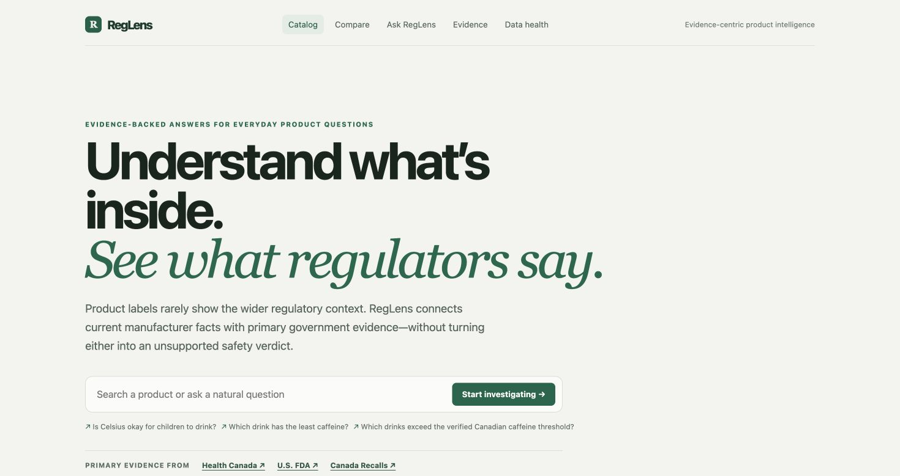
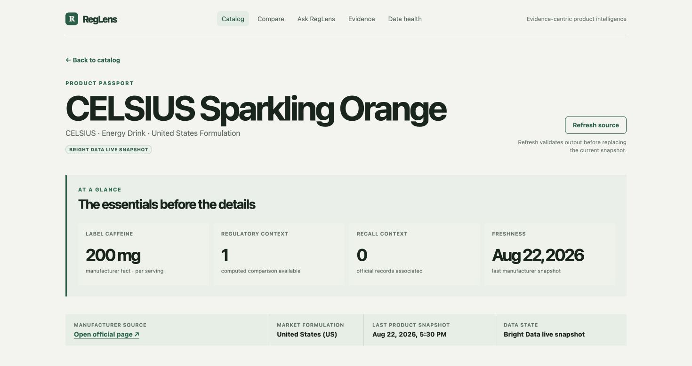
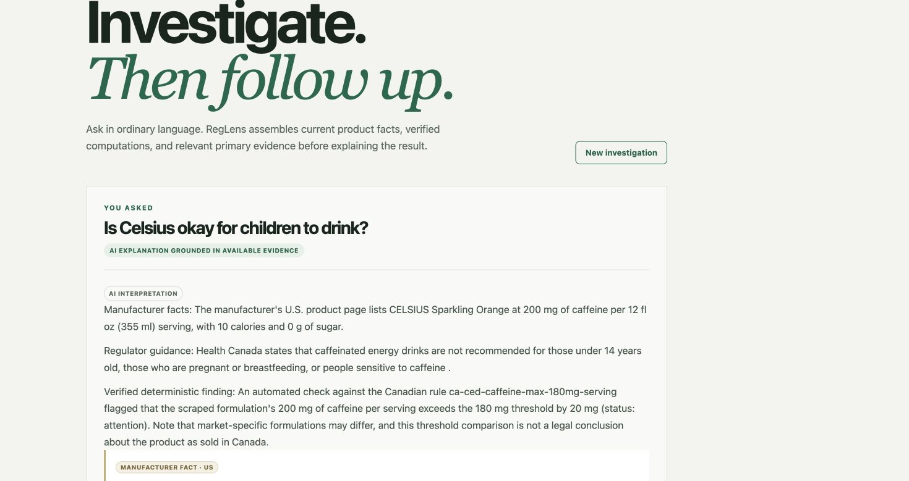
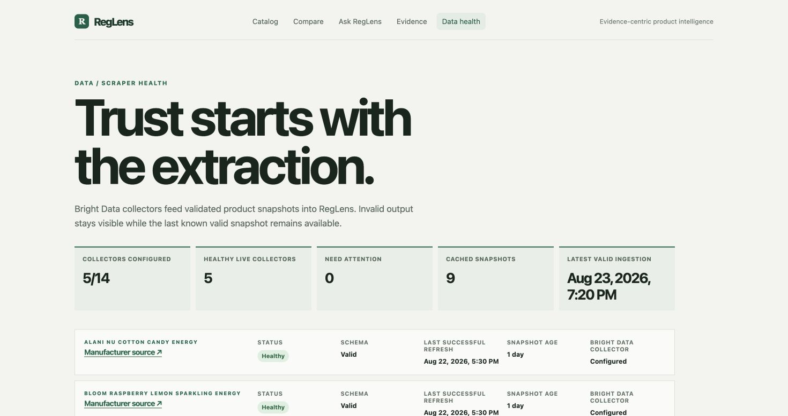
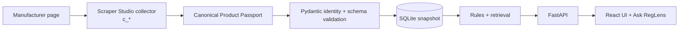
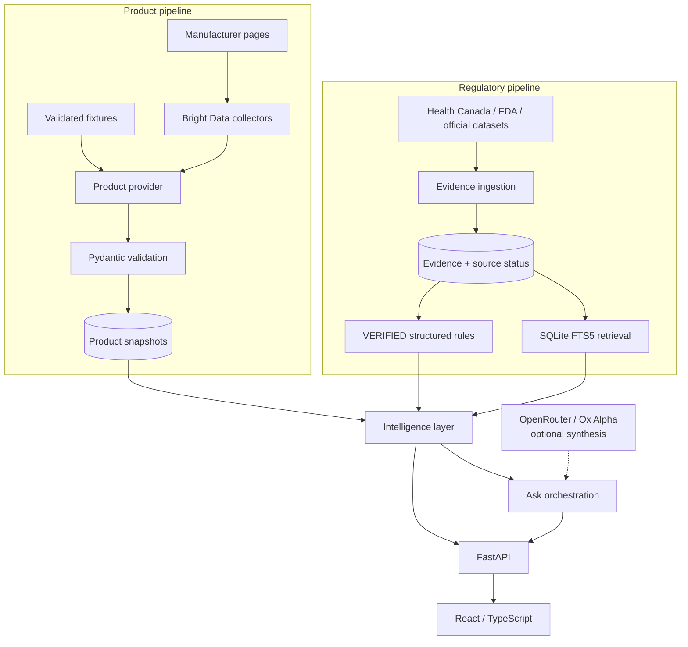
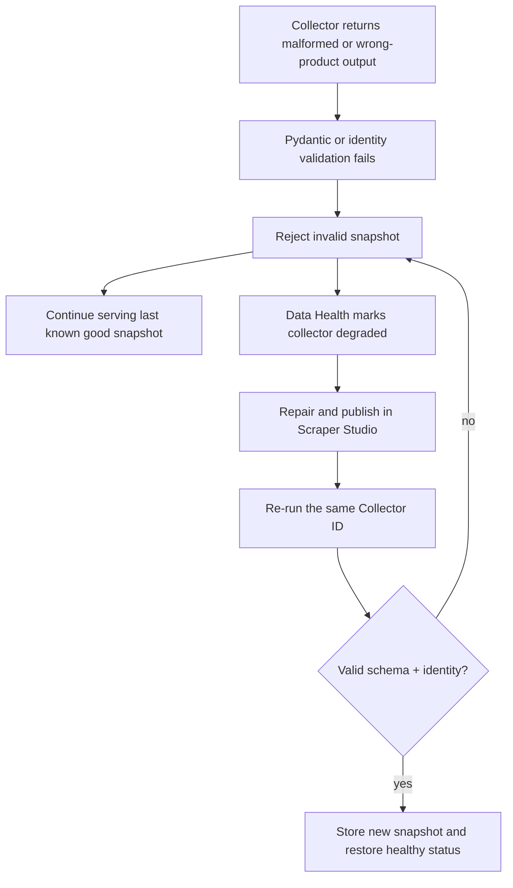

# RegLens

> **Know what's in the product. See what the evidence says.**



RegLens turns live manufacturer product pages into structured Product Passports,
then connects them to authoritative regulatory evidence, deterministic rule
checks, and evidence-grounded AI answers.

[Demo walkthrough](DEMO_SCRIPT.md) · [Architecture](ARCHITECTURE.md) ·
[Scraper Studio collectors](scrapers/COLLECTORS.md)

## Why RegLens exists

Product labels show ingredients and nutrition, but rarely explain the wider
regulatory context. The same product family can also have different
formulations in different markets.

Regulatory evidence is fragmented across government websites, documents, and
datasets. Finding the relevant rule—and proving which formulation it applies
to—requires more than a generic web search.

RegLens continuously connects validated manufacturer snapshots to primary
regulatory evidence. Exact comparisons stay deterministic, every conclusion
retains provenance, and AI is used only to explain the evidence assembled
before it.

## See the product

| Product Passport | Ask RegLens |
| --- | --- |
|  |  |

| Homepage discoveries | Data and scraper health |
| --- | --- |
| Source-backed “Did you know?” cards invite exploration without making unsupported health claims. |  |

The fixture-first catalog currently covers fourteen products across energy
drinks, soft drinks, candy, snacks, and instant noodles. Market variants remain
distinct: Fanta Orange Canada and Fanta Orange Saudi Arabia have separate
sources, snapshots, and ingredient statements.

## What makes RegLens different?

| Generic AI search | RegLens |
| --- | --- |
| Searches and summarizes web information | Maintains validated, structured product snapshots |
| May blend product facts and regulation into one answer | Separates manufacturer facts, regulatory evidence, computations, and AI interpretation |
| May not establish which formulation was used | Tracks the exact product variant, market, serving basis, source, and capture time |
| Asks the model to perform most reasoning | Uses deterministic rules for measurable comparisons |
| Sources may be loosely connected to claims | Findings retain primary-source provenance and evidence status |
| A failed scrape can silently change an answer | Rejects invalid snapshots and keeps the last known good result available |

## Why Bright Data Scraper Studio is core

Manufacturer sites disagree on markup, terminology, and where they hide label
data. Bright Data Scraper Studio is the acquisition layer that turns those
different sites into one stable downstream contract.



The operating loop is **create → run → validate → store → detect failure →
repair in Studio → re-run**. Bright Data is not a bolt-on search API: collector
output crosses a strict identity and schema boundary before it can replace a
trusted product snapshot.

### Collector proof

Collector IDs are identifiers, not API credentials. The following collectors
have a last accepted, schema-valid snapshot in the current integration:

| Product | Market | Collector ID | Integration state |
| --- | --- | --- | --- |
| Alani Nu Cotton Candy Energy | US | `c_mt4gy8rx2lzhs4i7t3` | Valid snapshot |
| Bloom Raspberry Lemon Sparkling Energy | US | `c_mt5h1wyo1oqt0sb0st` | Valid snapshot |
| Brach's Classic Jelly Beans | US | `c_mt5uzri62rgqs8h4cg` | Live output and exact identity validated |
| C4 Performance Energy Frozen Bombsicle | US | `c_mt4h7tha1vzjhzgtdq` | Valid snapshot |
| CELSIUS Sparkling Orange | US | `c_mt5jdg5m1xjgja3y96` | Valid snapshot |

Additional prototype collectors and the exact manual work still required for
each are documented honestly in [scrapers/COLLECTORS.md](scrapers/COLLECTORS.md).
A Collector ID alone is never treated as proof that its output is production
ready.

The tracked [`scrapers/`](scrapers/) directory is reviewed reference code for
Bright Data Scraper Studio and local parser regression tests. FastAPI and React
do **not** import or execute those JavaScript files. A maintainer copies the
reviewed interaction and parser code into Studio, publishes it, and configures
the Collector ID; RegLens consumes only the resulting API output.

## One contract for every manufacturer

```json
{
  "brand": "Alani Nu",
  "product_name": "Cotton Candy",
  "product_line": "Energy Drink",
  "flavor": "Cotton Candy",
  "serving_size": {"value": 12, "unit": "fl oz", "ml": 355},
  "caffeine_mg": 200,
  "calories": 10,
  "sugar_g": 0,
  "nutrition_facts": [
    {"name": "Sodium", "value": 180, "unit": "mg", "daily_value_percent": 8}
  ],
  "ingredients": ["Carbonated Water", "Citric Acid", "Caffeine"],
  "warnings": ["Not recommended for children, people sensitive to caffeine, pregnant women or women who are nursing."],
  "claims": ["Gluten free", "Vegan", "Sugar free"],
  "source": {
    "url": "https://www.alaninu.com/products/energy-drink-cotton-candy",
    "market": "US",
    "scraped_at": "2026-08-22T12:00:00Z"
  }
}
```

Different manufacturer websites, one stable Product Passport contract.
Unavailable scalars remain `null`; unavailable collections remain `[]`.
RegLens never converts a missing value into zero.

## Architecture

The product and regulatory pipelines remain independent until the intelligence
layer joins them for a specific question or rule evaluation.



SQLite stores append-only product snapshots, normalized regulatory sources,
rules, findings, recalls, and full-text retrieval data. FastAPI exposes the
catalog, compare, evidence, health, refresh, and Ask flows to a React SPA.

For the complete data lifecycle and domain decisions, read
[ARCHITECTURE.md](ARCHITECTURE.md).

## Trust is part of the data model

RegLens keeps four epistemic layers visibly separate:

| Layer | Meaning |
| --- | --- |
| **Manufacturer fact** | What the current first-party product source says |
| **Regulatory evidence** | What an identified authority says, with jurisdiction, date, excerpt, and URL |
| **Computed finding** | A reproducible comparison between compatible product facts and a verified rule |
| **AI interpretation** | A plain-language explanation grounded in the three layers above |

Regulatory records also carry an evidence state:

- `VERIFIED` — primary evidence with applicability clear enough for
  deterministic evaluation.
- `SUPPORTED` — authoritative context that may be displayed but is not turned
  into threshold logic.
- `NEEDS_REVIEW` — ambiguous, stale, secondary, or unresolved evidence; it
  cannot generate an automated finding.

For example, RegLens can compare a U.S. CELSIUS snapshot containing 200 mg of
caffeine per serving with Health Canada's verified 180 mg comparison point for
Canadian caffeinated energy drinks. It presents regulatory context—not a claim
that the U.S. formulation is sold illegally in Canada.

## Reliability and the self-healing workflow



RegLens does not claim an undocumented automatic self-healing API. Repair is a
deliberate Studio workflow; detection, rejection, last-known-good fallback,
and recovery are enforced by the application.

## Tech stack

**Bright Data Scraper Studio** · **FastAPI** · **Pydantic** · **SQLite/FTS5** ·
**React** · **TypeScript** · **Vite** · **OpenRouter/Ox Alpha** · **Ruff** ·
**pytest**

## Run locally

The default path is an offline, fixture-backed demo. It requires no Bright Data
or OpenRouter account.

Requirements: Python 3.11+, [`uv`](https://docs.astral.sh/uv/), and Node.js 20+.

```bash
git clone https://github.com/kailash1372/shelf_signal.git
cd shelf_signal
cp .env.example .env
uv sync
uv run uvicorn app.main:app --app-dir backend --reload
```

In a second terminal:

```bash
cd frontend
npm install
npm run dev
```

Open [http://localhost:5173](http://localhost:5173). The Vite development
server proxies `/api` and `/health` to FastAPI at `http://localhost:8000`.
Interactive API documentation is available at
[http://localhost:8000/docs](http://localhost:8000/docs).

### Optional live providers

The complete configuration contract is documented in
[`.env.example`](.env.example). Keep `.env` untracked and never commit tokens.

To use Bright Data, configure `BRIGHTDATA_API_TOKEN`, the desired
`BRIGHTDATA_COLLECTOR_*` values, and:

```dotenv
REGLENS_DATA_PROVIDER=brightdata
```

To enable optional model synthesis, configure:

```dotenv
OPENROUTER_API_KEY=...
OPENROUTER_MODEL=stealth/ox-alpha
```

Without an OpenRouter key, Ask RegLens returns a deterministic, source-grounded
local answer. Product facts and rule results are assembled before any model
call; the LLM cannot create regulatory rules.

Externally billed Ask and refresh endpoints include configurable process-local
rate limits. A public multi-worker deployment should also enforce shared limits
at the hosting edge.

## Quality gates

```bash
uv run ruff format --check .
uv run ruff check .
uv run pytest -q

cd frontend
npm run lint
npm run typecheck
npm run build
```

Current repository baseline: **65 backend tests passing**, plus passing frontend
lint, TypeScript type-check, and production build. These commands are re-run
before submission rather than treated as permanent badges.

## Repository guide

| Path | Purpose |
| --- | --- |
| [`backend/app/`](backend/app/) | FastAPI application, domain models, services, repositories, and providers |
| [`frontend/src/`](frontend/src/) | React/TypeScript interface |
| [`scrapers/products/`](scrapers/products/) | Reviewed Scraper Studio reference collectors |
| [`backend/app/data/fixtures/`](backend/app/data/fixtures/) | Validated offline Product Passport snapshots |
| [`ARCHITECTURE.md`](ARCHITECTURE.md) | Detailed architecture and data lifecycle |
| [`DEMO_SCRIPT.md`](DEMO_SCRIPT.md) | Concise live/video demonstration flow |

## Current limitations and responsible use

- RegLens supports a curated product catalog and selected regulatory domains;
  it is not a complete global regulation database.
- Fixture snapshots are an offline development baseline, not proof that a
  manufacturer page remains unchanged.
- Some manufacturer sites expose important label data only through images or
  dynamic panels. RegLens retains authoritative image URLs and leaves
  unverified scalar fields empty rather than guessing.
- Product formulations can differ across markets and package sizes. RegLens
  preserves market and serving basis and does not silently compare incompatible
  quantities.
- Ingredient alias normalization is conservative. A possible synonym does not
  become a regulatory match until its nomenclature is verified.
- Only verified structured rules drive automated findings. Supported guidance
  remains contextual evidence.
- RegLens provides regulatory context and evidence navigation, not medical or
  legal advice, and does not classify products simply as safe or unsafe.

---

**RegLens makes the chain inspectable:** manufacturer source → validated
product snapshot → authoritative evidence → deterministic finding → optional
AI explanation.
